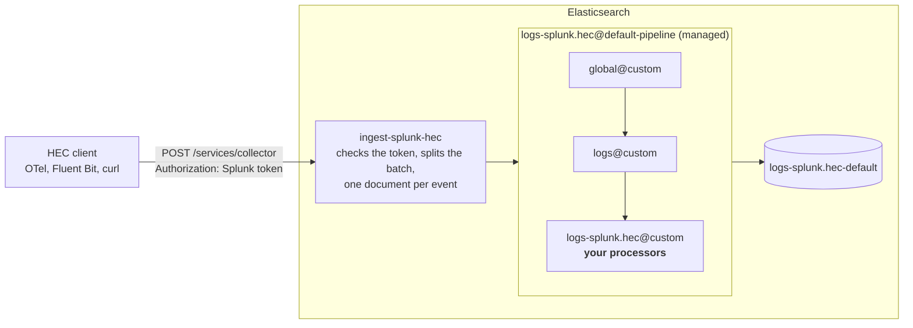

# elastic-ingest-splunk-hec

An Elasticsearch plugin that speaks **Splunk's HTTP Event Collector (HEC)** API. Anything that sends to Splunk HEC
(OpenTelemetry Collector, Fluent Bit, Vector, Splunk logging libraries, scripts) can point at Elasticsearch unchanged.

> **Community project**, not an official Elastic product, and not affiliated with or endorsed by Splunk. Each zip
> works with exactly one Elasticsearch version. Splunk is a trademark of Splunk LLC; Elastic and Elasticsearch are
> trademarks of Elasticsearch B.V.



The `@custom` pipelines run only if they exist; yours is where parsing goes.

## Install

Download the zip for your Elasticsearch version from [Releases](../../releases/latest).

* **Self-managed:** `bin/elasticsearch-plugin install file:///path/to/ingest-splunk-hec-<version>-es<es>.zip` on every node, then a rolling restart.
* **Elastic Cloud:** Extensions → create a *plugin* extension with the zip, then enable it on the deployment.

## Set up

Let HEC requests reach the plugin (user settings or `elasticsearch.yml`). The role is built in and has no privileges:

```yaml
xpack.security.authc.anonymous.username: splunk_anonymous
xpack.security.authc.anonymous.roles: splunk_hec_anonymous
xpack.security.authc.anonymous.authz_exception: false
```

Give the plugin a key to write with, and store its `encoded` value in the keystore as `splunk_hec.api_key`
(Cloud: Security → Elasticsearch keystore), then `POST _nodes/reload_secure_settings`:

```
POST _security/api_key
{"name":"splunk-hec","role_descriptors":{"writer":{"indices":[{"names":["logs-*-*"],"privileges":["create_doc","auto_configure"]}]}}}
```

Create a token, or keep the one your senders already use with Splunk: Elasticsearch stores only its SHA-256, and
the name becomes `splunk.token_name`:

```bash
TOKEN=$(python3 -c "import uuid; print(uuid.uuid4())"); printf %s "$TOKEN" | sha256sum
printf %s "$SPLUNK_TOKEN" | sha256sum                   # the token your senders already have
```

```
PUT _cluster/settings
{"persistent":{"splunk_hec.token_sha256":["my-app=<sha256>"]}}
```

## Test it

```bash
H=https://<elasticsearch-endpoint>/services/collector; J='Content-Type: application/json'

curl -s $H/health                                                       # {"text":"HEC is healthy","code":17}
curl -s $H/event -H "Authorization: Splunk $TOKEN" -H "$J" \
  -d '{"time":1760000000,"host":"web01","sourcetype":"app:log","event":"user login ok"}'     # {"text":"Success","code":0}
curl -s $H/event -H "Authorization: Splunk $TOKEN" -H "$J" \
  -d '{"event":"first"}{"event":"second"}'                              # a batch: two documents
curl -s "$H/raw?sourcetype=syslog" -H "Authorization: Splunk $TOKEN" -H "$J" \
  --data-binary $'line one\nline two'                                   # raw: one document per line
```

```esql
FROM logs-splunk.hec-default | KEEP @timestamp, splunk.sourcetype, message | SORT @timestamp DESC | LIMIT 10
```

Send `Content-Type: application/json` or none: Elasticsearch rejects `text/plain` and `curl -d`'s default
form type (406) before the plugin sees the request.

## Documents

Events land in `logs-splunk.hec-default`. By default the plugin parses nothing: an `/event` event's `message` is
its JSON exactly as sent, a `/raw` line is the line, `@timestamp` is the arrival time, and `splunk.host`,
`.source`, `.sourcetype`, `.index` come from the query string (else Splunk's defaults). Parse in the
`logs-splunk.hec@custom` ingest pipeline, which the plugin's default pipeline calls for every event.

`event.ingested` is when Elasticsearch received the event. `agent.type` and `agent.version` name the sender, from its User-Agent (`Fluent-Bit/3.2.1`); they are absent when
it sends none or no name. `event.module: splunk_hec` says this plugin received the event.

With `envelope: unwrap`, indexed fields go to `splunk.fields`, one `flattened` field however many keys senders
use: query `splunk.fields.env: prod` in KQL or a `term` query. ES|QL returns it as one JSON column; filter with
`WHERE QSTR("splunk.fields.env:prod")`, or read a key with `JSON_EXTRACT(_source, "splunk.fields.env")` after
`FROM … METADATA _source`.

## Settings

| setting | default | |
|---|---|---|
| `splunk_hec.token_sha256` | — | allowed tokens, `name=<sha256>`; each `PUT` replaces the list |
| `splunk_hec.target` | `logs-splunk.hec-default` | data stream; `{sourcetype}` / `{index}` placeholders |
| `splunk_hec.envelope` | `keep` | `unwrap`: the plugin unwraps events itself (time, host, source, sourcetype, index, fields) |
| `splunk_hec.metadata` | `minimal` | `full`: also record request details (id, node, sender address, user agent) |
| `splunk_hec.ack` | `false` | indexer acknowledgment: requests with a channel (a GUID) get an `ackId` |
| `splunk_hec.query_string_auth` | `false` | accept `?token=` |
| `splunk_hec.api_key` | — | keystore; the identity events are indexed as |

All but the keystore entry are cluster settings: change one at any time, no restart.

The plugin's index template (flattened `splunk.fields`, the default pipeline) covers `logs-splunk.hec-*`. For one
stream per sourcetype keep it by putting the placeholder in the namespace, `logs-splunk.hec-{sourcetype}`. A
target outside `logs-splunk.hec-*`, such as `logs-splunk.{sourcetype}-default`, gets Elasticsearch's built-in
`logs` template instead, and of the `@custom` pipelines only `logs@custom` runs.

An event Elasticsearch rejects (your pipeline fails, a mapping conflict) is answered `Success` like Splunk's
indexed events and lands in the stream's failure store, `logs-splunk.hec-default::failures` (on by default for
`logs-*-*`); with the failure store off, the sender gets code 6 with the event's number.

```
PUT _cluster/settings
{"persistent":{"splunk_hec.target":"logs-myapp-default"}}

# back to the default
PUT _cluster/settings
{"persistent":{"splunk_hec.target":null}}
```

`GET _cluster/settings?include_defaults&filter_path=*.splunk_hec*` shows them.

## Compatibility with Splunk

`compat/` replays 69 edge-case requests against any HEC endpoint and diffs the answers with Splunk's: what
matches and what doesn't is in [compat/README.md](compat/README.md).

## Build

```bash
./build-plugin.sh                     # Elasticsearch 9.5.4 -> dist/ (Docker only; runs the tests)
ES_VERSION=9.5.5 ./build-plugin.sh
```
